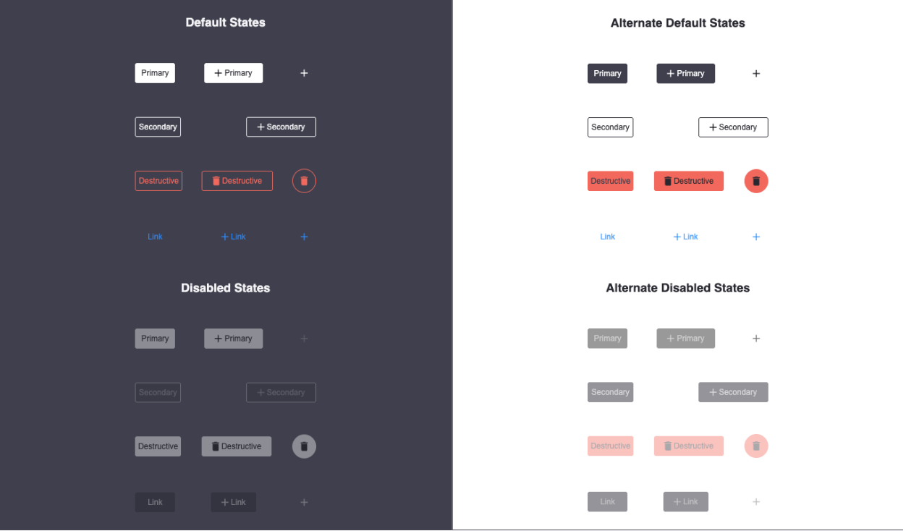
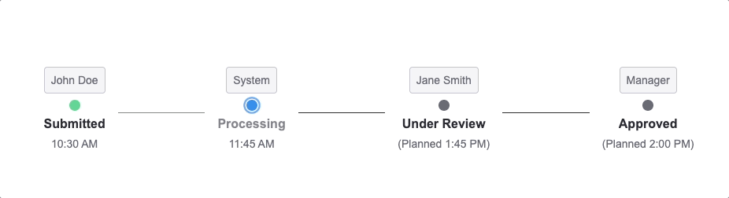

[](https://badge.fury.io/js/%40woven-planet%2Flakefront)

# lakefront
Lakefront is a simple React component library.

## Installation

Lakefront is available as an [npm package](https://www.npmjs.com/package/@woven-planet/lakefront).

```sh
// with npm
npm install @woven-planet/lakefront

// with yarn
yarn add @woven-planet/lakefront
```

Emotion's `ThemeProvider` must wrap your application for the components to style correctly.
```
import { ThemeProvider } from '@emotion/react';
import { theme } from '@woven-planet/lakefront';

<ThemeProvider theme={theme}>
    ...
</ThemeProvider>
```

## Usage
### ⚠️ <b>LakeFront requires the client application to use the React and Node versions listed in the [package.json](./package.json) ⚠️ </b>


Here is a quick example to get you started, **it's all you need**:

```jsx
import { createRoot } from 'react-dom/client';
import { Button } from '@woven-planet/lakefront';

function App() {
    return <Button>Hello World</Button>;
}

createRoot.render(<App />, document.querySelector('#app'));

```
## Contributing
If you want to contribute to the action, even by just raising a problem or proposing an idea, you can click [here](CONTRIBUTING.md) to find out how to do it.

---
## Npm Dependencies Maintenance
Dependencies in the [package.json](package.json) should be kept up to date to avoid unexpected issues. A report of
outdated dependencies is rebuilt nightly and published to
[the dependencies page](https://woven-by-toyota.github.io/lakefront/dependencies/), alongside the Storybook. It covers
both `dependencies` and `devDependencies`, and the same content is written to the workflow's job summary so a failed
publish does not lose it.

### Review cadence
Review it **once per sprint**, at planning:

1. Open the report. Anything under Patch or Minor is routine; apply it as one pull request.
2. For each new entry under Major, raise a ticket rather than attempting it inline.
3. Check the repository's security alerts as well. The report shows versions, not vulnerabilities, so it will not
   surface a CVE on a package that is otherwise current.

### The one major still outstanding
`@tanstack/react-table` 9 is the only one left, and it is a rewrite rather than an upgrade, so it has its own
ticket. Version 9 replaces the imperative table instance with a store and atoms model: `getRowModel`,
`getHeaderGroups`, `getAllLeafColumns` and `getState` are all gone, and those are what `Table.tsx` renders from.
It also makes features opt-in, so `TableFeatures` becomes the first type argument on nearly every type and
`ColumnDef` turns into a union of per-feature shapes. `ColumnDef` is re-exported from here as `TableColumn`, so
the public surface is involved too, so it is a breaking change for anyone typing their columns with it. It
needs a visual pass in Storybook and a `build-copy` check against a consuming application before release.

### Toolchain notes worth keeping
Two constraints are easy to trip over when touching the build:

- **Linting and formatting are Biome, not ESLint**, configured in `biome.jsonc`. `npm run lint` runs
  `biome check`, which covers lint, format and import order together; `npm run lint:fix` writes the fixes.
  Biome parses TypeScript itself, so linting is not tied to the compiler version the way ESLint was:
  typescript-eslint refuses TypeScript 7 outright, from a runtime guard, with no release or canary that
  allows it. Each non-default choice in the config carries a comment explaining itself.
- **`isolatedModules` is required, not optional.** swc transpiles one file at a time and cannot tell an interface
  from a value, so every type re-export needs the inline `type` modifier. Removing the flag would let the build
  break at bundle time rather than at type-check time.

Three high findings also have no published fix: `@storybook/builder-webpack5`, `@storybook/react-webpack5` and
`webpack-dev-middleware`, all reached only through the Storybook dev server.

---
## Storybook Components
We've added Storybook pages to show how each component can be used.

---
## How to add components to this table
Upon a new component being added to this table run 'npm run update-readme' for boilerplate code. Please replace the three variables with the corresponding information as needed. Also, store screenshots of components in the 'screenshots' folder.

Please do not add information below this table, the 'npm run update-readme' will not work properly if the table is not last.
---
| Component                                                                                                                                  | Picture                                                                                              | Component                                                                                                                                            | Picture                                                                                                 |
|:-------------------------------------------------------------------------------------------------------------------------------------------|:-----------------------------------------------------------------------------------------------------|:-----------------------------------------------------------------------------------------------------------------------------------------------------|:--------------------------------------------------------------------------------------------------------|
| [AnchorCopy](https://woven-by-toyota.github.io/lakefront/?path=/docs/lakefront-anchorcopy--anchor-copy)                                       | <details><summary>Screenshot</summary></details>           | [BoundingBoxes](https://woven-by-toyota.github.io/lakefront/?path=/docs/lakefront-boundingboxes--bounding-boxes)                                        | <details><summary>Screenshot</summary></details>           |
 | [Breadcrumb](https://woven-by-toyota.github.io/lakefront/?path=/docs/lakefront-breadcrumb--docs)                                        | <details> <summary>Screenshot</summary></details>          | [Button](https://woven-by-toyota.github.io/lakefront/?path=/docs/lakefront-button--all-buttons)                                                         | <details><summary>Screenshot</summary></details>                  |
 | [Card](https://woven-by-toyota.github.io/lakefront/?path=/docs/lakefront-card--card)                                                          | <details><summary>Screenshot</summary></details>                 | [Checkbox](https://woven-by-toyota.github.io/lakefront/?path=/docs/lakefront-checkbox--checkbox)                                                        | <details><summary>Screenshot</summary></details>               |
| [CheckboxGroup](https://woven-by-toyota.github.io/lakefront/?path=/docs/lakefront-checkboxgroup--checkbox-group)                              | <details><summary>Screenshot</summary></details>       | [PopoverContent](https://woven-by-toyota.github.io/lakefront/?path=/docs/lakefront-popovercontent--popover-content)                                     | <details><summary>Screenshot</summary></details>          |
| [Collapsible](https://woven-by-toyota.github.io/lakefront/?path=/docs/lakefront-collapsible--collapsible)                                     | <details><summary>Screenshot</summary></details>          | [CopyButton](https://woven-by-toyota.github.io/lakefront/?path=/docs/lakefront-copybutton--copy-button)                                                 | <details><summary>Screenshot</summary></details>             |
 | [Drawer](https://woven-by-toyota.github.io/lakefront/?path=/docs/lakefront-drawer--drawer)                                                    | <details><summary>Screenshot</summary></details>               | [Filter](https://woven-by-toyota.github.io/lakefront/?path=/docs/lakefront-filter-allfilters--no-filter-bar)                                            | <details><summary>Screenshot</summary></details>                  |
 | [AdditionalJSONFilter](https://woven-by-toyota.github.io/lakefront/?path=/docs/lakefront-filter-additionaljsonfilter--additional-json-filter) | <details><summary>Screenshot</summary></details> | [DoubleMultiSelectFilter](https://woven-by-toyota.github.io/lakefront/?path=/docs/lakefront-filter-doublemultiselectfilter--double-multi-select-filter) | <details><summary>Screenshot</summary></details> |
 | [DurationFilter](https://woven-by-toyota.github.io/lakefront/?path=/docs/lakefront-filter-durationfilter--duration-filter)                    | <details><summary>Screenshot</summary></details>       | [ListFilter](https://woven-by-toyota.github.io/lakefront/?path=/docs/lakefront-filter-listfilter--list-filter)                                          | <details><summary>Screenshot</summary></details>              |
 | [MultiSelectFilter](https://woven-by-toyota.github.io/lakefront/?path=/docs/lakefront-filter-multiselectfilter--multi-select-filter)          | <details><summary>Screenshot</summary></details>    | [RadioFilter](https://woven-by-toyota.github.io/lakefront/?path=/docs/lakefront-filter-radiofilter--radio-filter)                                       | <details><summary>Screenshot</summary></details>             |
 | [SingleSelectFilter](https://woven-by-toyota.github.io/lakefront/?path=/docs/lakefront-filter-singleselectfilter--single-select-filter)       | <details><summary>Screenshot</summary></details>   | [TextFilter](https://woven-by-toyota.github.io/lakefront/?path=/docs/lakefront-filter-textfilter--text-filter)                                          | <details><summary>Screenshot</summary></details>              |
 | [Header](https://woven-by-toyota.github.io/lakefront/?path=/docs/lakefront-header--header)                                                    | <details><summary>Screenshot</summary></details>               | [Input](https://woven-by-toyota.github.io/lakefront/?path=/docs/lakefront-input--placeholder)                                                           | <details><summary>Screenshot</summary></details>                   |
 | [ItemGrid](https://woven-by-toyota.github.io/lakefront/?path=/docs/lakefront-itemgrid--item-grid)                                             | <details><summary>Screenshot</summary></details>             | [ItemResults](https://woven-by-toyota.github.io/lakefront/?path=/docs/lakefront-itemresults--item-results)                                              | <details><summary>Screenshot</summary></details>             |
 | [Loading](https://woven-by-toyota.github.io/lakefront/?path=/docs/lakefront-loading--loading)                                                 | <details><summary>Screenshot</summary></details>              | [MaskableImage](https://woven-by-toyota.github.io/lakefront/?path=/docs/lakefront-maskableimage--maskable-image)                                        | <details><summary>Screenshot</summary></details>           |
 | [Modal](https://woven-by-toyota.github.io/lakefront/?path=/docs/lakefront-modal--simple-modal)                                                | <details><summary>Screenshot</summary></details>                | [ConfirmationModal](https://woven-by-toyota.github.io/lakefront/?path=/docs/lakefront-modal-confirmationmodal--basic-confirm)                           | <details><summary>Screenshot</summary></details>       |
 | [Page](https://woven-by-toyota.github.io/lakefront/?path=/docs/lakefront-page--page)                                                          | <details><summary>Screenshot</summary></details>                 | [PlaybackBar](https://woven-by-toyota.github.io/lakefront/?path=/docs/lakefront-playbackbar--playback-bar)                                              | <details><summary>Screenshot</summary></details>             |
 | [Progress](https://woven-by-toyota.github.io/lakefront/?path=/docs/lakefront-progress-progressbar--progress-bar)                              | <details><summary>Screenshot</summary></details>             | [Circular Progress](https://woven-by-toyota.github.io/lakefront/?path=/docs/lakefront-progress-circularprogress--circular-progress)                     | <details><summary>Screenshot</summary></details>        |
 | [Device Progress](https://woven-by-toyota.github.io/lakefront/?path=/docs/lakefront-progress-deviceprogress--default-progress-bar)            | <details><summary>Screenshot</summary></details>       | [Progress Bar](https://woven-by-toyota.github.io/lakefront/?path=/docs/lakefront-progress-progressbar--progress-bar)                                    | <details><summary>Screenshot</summary></details>             |
 | [PropertyList](https://woven-by-toyota.github.io/lakefront/?path=/docs/lakefront-propertylist--property-list)                                 | <details><summary>Screenshot</summary></details>         | [RadioGroup](https://woven-by-toyota.github.io/lakefront/?path=/docs/lakefront-radiogroup--standard-radio-group)                                        | <details><summary>Screenshot</summary></details>              |
 | [RefreshToolBar](https://woven-by-toyota.github.io/lakefront/?path=/docs/lakefront-refreshtoolbar--refresh-toolbar)                           | <details><summary>Screenshot</summary></details>       | [Select](https://woven-by-toyota.github.io/lakefront/?path=/docs/lakefront-select--select)                                                              | <details><summary>Screenshot</summary></details>                  |
 | [SelectPopover](https://woven-by-toyota.github.io/lakefront/?path=/docs/lakefront-selectpopover--popover)                                     | <details><summary>Screenshot</summary></details>        | [Snackbar](https://woven-by-toyota.github.io/lakefront/?path=/docs/lakefront-snackbar)                                                                  | <details><summary>Screenshot</summary></details>                |
 | [SpeedInput](https://woven-by-toyota.github.io/lakefront/?path=/docs/lakefront-speedinput--speed-input)                                       | <details><summary>Screenshot</summary></details>           | [StackBanner](https://woven-by-toyota.github.io/lakefront/?path=/docs/lakefront-stack-banner--stack-banner)                                             | <details><summary>Screenshot</summary></details>             |
 | [StackBannerRow](https://woven-by-toyota.github.io/lakefront/?path=/docs/lakefront-stack-banner-stack-banner-row--error)                      | <details><summary>Screenshot</summary></details>       | [StepFunctionAuthoring](https://woven-by-toyota.github.io/lakefront/?path=/docs/lakefront-stepfunctionauthoring--new-step-function)                     | <details><summary>Screenshot</summary></details>   |
 | [StatusTable](https://woven-by-toyota.github.io/lakefront/?path=/docs/lakefront-statustable--status-table-with-table-card)                    | <details><summary>Screenshot</summary></details>          | [StatusTracker](https://woven-by-toyota.github.io/lakefront/?path=/docs/lakefront-statustracker--basic-status-tracker)                                  | <details><summary>Screenshot</summary></details>           |
 | [StatusTrackerPopover](https://woven-by-toyota.github.io/lakefront/?path=/docs/lakefront-statustrackerpopover--basic-popover)                 | <details><summary>Screenshot</summary></details> | [StepFunctionGraph](https://woven-by-toyota.github.io/lakefront/?path=/docs/lakefront-stepfunctiongraph--simple-graph)                                  | <details><summary>Screenshot</summary></details>   |
 | [StepFunctionRenderer](https://woven-by-toyota.github.io/lakefront/?path=/docs/lakefront-stepfunctionrenderer--step-function-renderer)        | <details><summary>Screenshot</summary></details> | [Table](https://woven-by-toyota.github.io/lakefront?path=/docs/lakefront-table--table)                                                                  | <details><summary>Screenshot</summary></details>                   |
 | [Tabs](https://woven-by-toyota.github.io/lakefront?path=/docs/lakefront-tabs--tabs)                                                           | <details><summary>Screenshot</summary></details>                 | [TextArea](https://woven-by-toyota.github.io/lakefront/?path=/docs/lakefront-textarea--placeholder)                                                     | <details><summary>Screenshot</summary></details>                |
 | [Toggle](https://woven-by-toyota.github.io/lakefront/?path=/docs/lakefront-toggle--toggle)                                                    | <details><summary>Screenshot</summary></details>               | [TypeaheadSearch](https://woven-by-toyota.github.io/lakefront/?path=/docs/lakefront-typeaheadsearch--search-bottom-start)                               | <details><summary>Screenshot</summary></details>         |
 | [ModeSelector](https://woven-by-toyota.github.io/lakefront/?path=/docs/lakefront-modeselector--simple-mode-selector)                          | <details><summary>Screenshot</summary></details>         | [Colors](https://woven-by-toyota.github.io/lakefront/?path=/docs/lakefront-theme-colors--docs)                                                          | <details><summary>Screenshot</summary></details>                  |
 | [ContextMenu](https://woven-by-toyota.github.io/lakefront/?path=/docs/lakefront-contextmenu--docs)                                                                        | <details><summary>Screenshot</summary></details>          | [ButtonGroup](https://woven-by-toyota.github.io/lakefront/?path=/docs/lakefront-buttongroup--docs)                                                                                  | <details><summary>Screenshot</summary></details>             |
